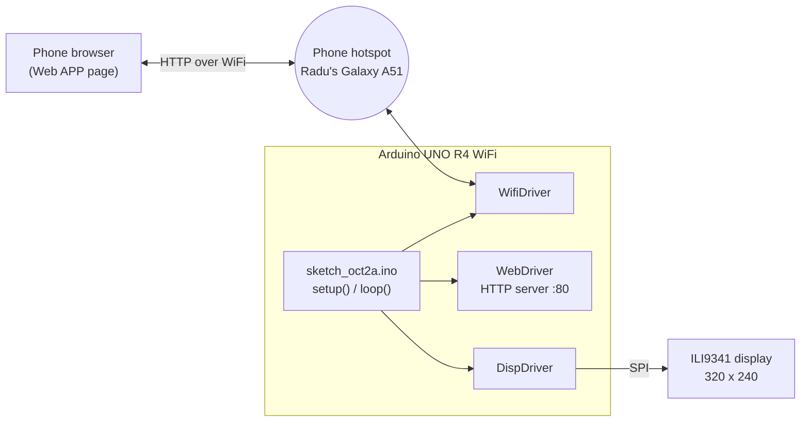
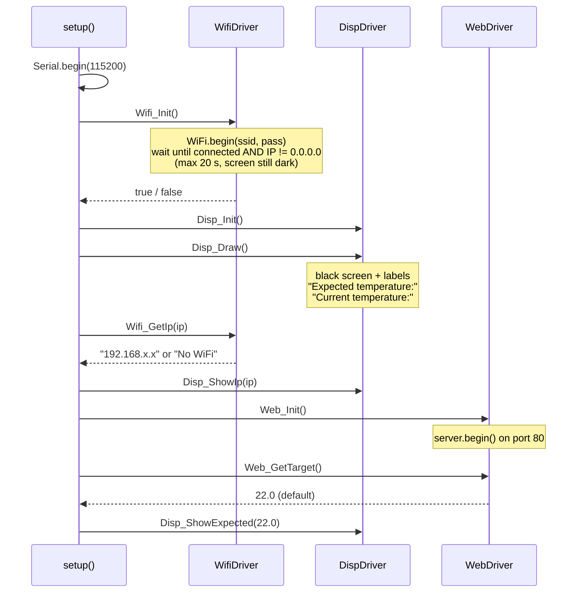
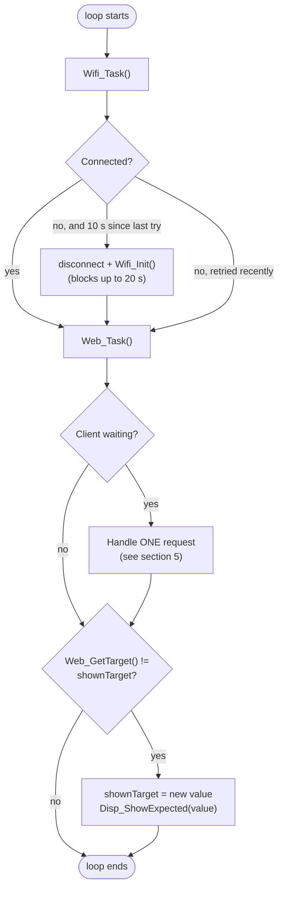
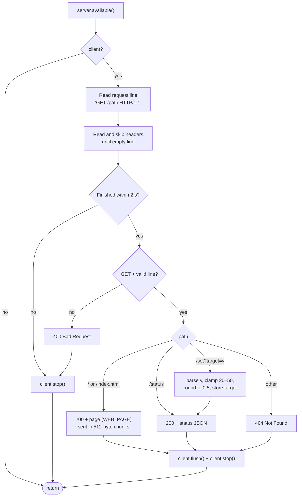
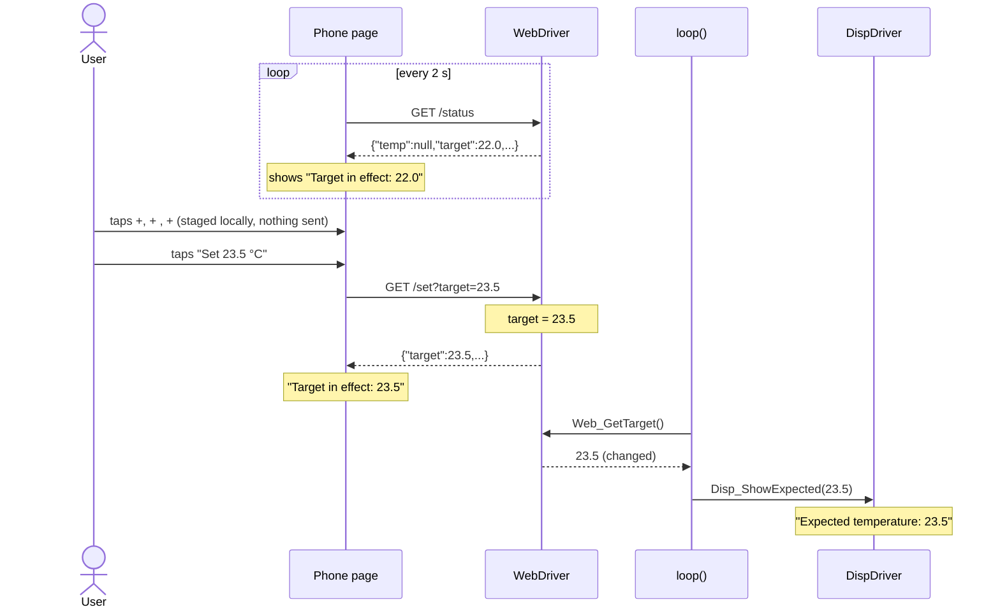
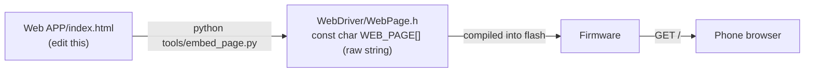

# System flow

How the temperature regulator firmware and the web page work together today.

> **Current scope:** WiFi, web page, display and the DS18B20 sensor are implemented. There is **no heater yet**,
> so the firmware always reports `power: 0`. `temp` is the DS18B20 reading, or `null` (the page shows `--`) if the sensor fails.

## 1. Big picture



The board joins the phone's hotspot as a normal WiFi client. The phone is the hotspot and also the browser,
so it can reach the board directly at the IP address shown at the bottom of the display.

**Rule of the architecture:** the `.ino` file only calls driver functions. Drivers never call each other:
`WebDriver` does not know the display exists, and `DispDriver` does not know about WiFi.
The main program is the only place that moves data between them.

## 2. Modules

| Module | Files | Responsibility | Public functions |
|---|---|---|---|
| Main | `sketch_oct2a.ino` | Startup order, main loop, passes data between drivers | `setup()`, `loop()` |
| WiFi driver | `src/Drivers/WifiDriver/` | Joins the hotspot, reconnects, reports the IP | `Wifi_Init`, `Wifi_IsConnected`, `Wifi_Task`, `Wifi_GetIp` |
| Web driver | `src/Drivers/WebDriver/` | HTTP server on port 80, serves the page, stores the target temperature | `Web_Init`, `Web_Task`, `Web_GetTarget` |
| Web page | `Web APP/index.html` → `WebDriver/WebPage.h` | Phone UI; polls the board, sends new targets | – |
| Display driver | `src/Drivers/DispDriver/` | Draws the main screen, target value and IP | `Disp_Init`, `Disp_Draw`, `Disp_ShowExpected`, `Disp_ShowIp`, `Disp_ShowDebug` |
| Embed tool | `tools/embed_page.py` | Copies `index.html` into `WebPage.h` (run on the PC, not on the board) | – |

## 3. Startup – `setup()`



If WiFi fails, startup still continues: the display shows `Web: http://No WiFi` and `loop()` keeps retrying.

## 4. Main loop – `loop()`



The loop is **polled and single-threaded**: each step runs to completion before the next one.
No interrupts are used by the project code (the WiFi, SPI and Serial libraries use their own internally).

## 5. One HTTP request – `Web_Task()`



### HTTP API

| Request | Effect | Response |
|---|---|---|
| `GET /` | – | The web page (HTML, ~10 KB) |
| `GET /status` | – | `{"temp":null,"target":22.0,"power":0,"fault":null}` |
| `GET /set?target=23.5` | Stores the new target (clamped to 20–50 °C, 0.5 °C steps). Non-numbers are ignored. | Same JSON as `/status`, with the new target |
| anything else | – | `404 Not Found` |

Every response has `Connection: close` and `Cache-Control: no-store`. One request is served per `Web_Task()` call.

## 6. End to end: pressing **Set** on the phone



The page never overlaps requests (the board answers one client at a time): polls are skipped while a
request is in flight, and a `/set` waits its turn. After 2 failed requests in a row the page shows
"No connection to the regulator. Retrying…" and recovers by itself on the next success.

## 7. The web page inside the firmware



- The Arduino IDE only compiles files inside the sketch folder, so the HTML must become a C header.
- `WebPage.h` is generated – edit `index.html` and re-run the script, then re-upload.
- Opened straight from disk (`file://`) or with `?mock=1`, the page runs in **mock mode** with a simulated
  regulator, so the UI can be tested without the board.

## 8. Display layout (320 × 240, rotation 1)

```
┌────────────────────────────────────────────┐
│                                            │
│  Expected temperature: 23.5     ← size 2   │  Disp_Draw label + Disp_ShowExpected value
│                                            │
│  Current temperature:           ← size 2   │  Disp_Draw label (no value yet – no sensor)
│                                            │
│  Web: http://192.168.x.x        ← size 1   │  Disp_ShowIp, bottom line
└────────────────────────────────────────────┘
```

The two size-2 lines are spaced evenly (`mainGap()`); values are redrawn by clearing only their own
rectangle, so the rest of the screen does not flicker.

## 9. Timing and blocking points

Everything runs in `loop()`, so any step that waits delays all the others:

| Where | Worst case | When |
|---|---|---|
| `Wifi_Init()` | 20 s | At startup, and on every reconnect attempt (at most every 10 s while WiFi is down) |
| `Web_Task()` reading a request | 2 s | A client connects but sends slowly or nothing |
| `Web_Task()` sending the page | a few hundred ms | Each time the page is (re)loaded |
| `Disp_ShowExpected()` | a few ms | Only when the target changes |

This is fine while the board only shows a value. Once a sensor and heater are added, the control step
should run on a fixed `millis()` schedule and the WiFi reconnect should be made non-blocking, so heating
is not paused while WiFi is down.

## 10. Configuration

| Setting | Where | Value |
|---|---|---|
| Hotspot name / password | `WifiDriver.cpp` (`WIFI_SSID`, `WIFI_PASS`) | `Radu's Galaxy A51` / `12345678` |
| Connect timeout / retry interval | `WifiDriver.cpp` | 20 s / 10 s |
| HTTP port, request timeout, chunk size | `WebDriver.cpp` | 80, 2 s, 512 B |
| Target range and default | `WebDriver.cpp` | 20–50 °C, default 22.0 °C |
| Display pins (CS / DC / RST) | `DispDriver.cpp` | 10 / 9 / 8, hardware SPI at 10 MHz |
| Serial log | `sketch_oct2a.ino` | 115200 baud |

The hotspot requires **2.4 GHz** and **WPA2** – the UNO R4 cannot join 5 GHz or WPA3-only networks.
